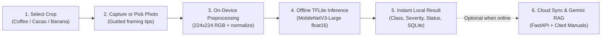

# HealthyCrop

[](https://github.com/keylorpineda/healthycrop/actions/workflows/ci.yml)
[](https://github.com/keylorpineda/healthycrop/blob/main/LICENSE)
[](https://github.com/keylorpineda/healthycrop/releases)

Offline-first Android app that detects coffee, cacao, and banana diseases from a phone photo, explains the result with grounded agronomic references, and tracks farms and plots.

> **Agronomic Disclaimer**: HealthyCrop is a non-commercial, open-source decision-support tool designed initially for Costa Rica. **It supports field decisions and does not replace a certified agronomist or phytosanitary laboratory.** Always consult an agricultural professional before applying agrochemicals or removing plants.

---

## Demo & Screenshots

*App screenshots and an Android screen recording demonstrating offline scanning, severity meters, and RAG explanations are added in Phases 3, 4, and 8.*

| Onboarding & Disclaimer | Camera & Framing Guide | Diagnosis Result & Severity | Farms, Plots & History |
| :---: | :---: | :---: | :---: |
| *Pending Phase 3* | *Pending Phase 4* | *Pending Phase 4* | *Pending Phase 4* |

---

## The Problem

Smallholder and medium-scale producers of coffee (*Coffea arabica* / *canephora*), cacao (*Theobroma cacao*), and banana (*Musa* spp.) in Costa Rica frequently work in mountainous or rural plots with intermittent or zero mobile connectivity. Identifying foliar and pod pathogens early—such as coffee leaf rust (*Hemileia vastatrix*), cacao frosty pod rot (*Moniliophthora roreri*), or black Sigatoka (*Pseudocercospora fijiensis*)—is critical to timing cultural controls and preventing yield loss, yet cloud-only diagnostic tools fail in the field when connectivity drops.

---

## How It Works



1. **Crop Selection**: The user selects **Coffee** (leaf, underside preferred), **Cacao** (pod), or **Banana** (leaf) prior to scanning so a dedicated specialist model runs for that crop.
2. **Offline On-Device Inference**: The captured photo is resized to `224x224`, decoded to raw RGB via `jpeg-js`, normalized using the exact training statistics, and evaluated locally by a float16 TensorFlow Lite model (`< 10 MB`) via `react-native-fast-tflite`.
3. **Actionable Triage & Thresholding**: If confidence falls below the model's validation-calibrated threshold, the app instructs the user to retake the photo (`"low confidence — retake the photo"`). Otherwise, it displays the predicted class, severity, confidence, and triage status (`healthy`, `watch`, or `act now`).
4. **Local Persistence & Optional Sync**: Scans, farms, and plots are stored locally in `expo-sqlite` with client-generated UUIDs. Creating an account is optional and used strictly to synchronize records idempotently through the FastAPI backend (`api/`).
5. **Grounded RAG Explanations**: When online, the backend retrieves passages from official technical manuals (e.g., ICAFE for coffee and public agricultural institutions for cacao and banana) and uses a free-tier Gemini Flash model to summarize next steps in plain Spanish (or English), citing the exact source and section.

---

## Supported Crops & Model Results

One `MobileNetV3-Large` model is trained and exported per crop (`224x224` RGB input, float16 TFLite `< 10 MB`).

| Crop | Plant Organ | Target Classes | Test Macro-F1 (Keras) | Test Acc Delta (TFLite vs. Keras) | Model Size | Confusion Matrix & Grad-CAM |
| :--- | :--- | :--- | :---: | :---: | :---: | :--- |
| **Coffee** | Leaf (underside preferred) | `healthy`, `leaf_rust` (+ severity), `leaf_miner`, `cercospora`, `brown_leaf_spot`, `red_spider_mite` | *Phase 2* | *Phase 2 (`<= 1 pp`)* | *Phase 2 (`< 10 MB`)* | [Model Card](docs/MODEL_CARD.md#2-coffee-leaf-model-coffee) |
| **Cacao** | Pod | `healthy`, `monilia` (by stage), `black_pod` (*Phytophthora*) | *Phase 5* | *Phase 5 (`<= 1 pp`)* | *Phase 5 (`< 10 MB`)* | [Model Card](docs/MODEL_CARD.md#3-cacao-pod-model-cacao) |
| **Banana** | Leaf | `healthy`, `black_sigatoka`, `fusarium_wilt` | *Phase 5* | *Phase 5 (`<= 1 pp`)* | *Phase 5 (`< 10 MB`)* | [Model Card](docs/MODEL_CARD.md#4-banana-leaf-model-banana) |

Full training protocols, ablations, and Costa Rican field validation metrics are documented in [`docs/EXPERIMENTS.md`](docs/EXPERIMENTS.md), [`docs/MODEL_CARD.md`](docs/MODEL_CARD.md), and [`docs/FIELD_VALIDATION.md`](docs/FIELD_VALIDATION.md).

---

## Tech Stack

- **Android App (`app/`)**: Expo (Development Build), Expo Router, React Native, TypeScript (`strict`), NativeWind, React Native Reanimated, Gesture Handler, `react-native-fast-tflite`, `expo-camera`, `expo-image-picker`, `expo-image-manipulator`, `jpeg-js`, `expo-sqlite`, `expo-haptics`, Zustand, TanStack Query, `i18next` (`es` default, `en` secondary), Firebase Auth (email/password).
- **Machine Learning (`ml/`)**: Python 3.12 (`uv`), TensorFlow / Keras (`MobileNetV3-Large`, TFLite float16 export), scikit-learn, pandas, Pillow, `imagehash`.
- **Backend API (`api/`)**: Python 3.12 (`uv`), FastAPI, Pydantic v2, Uvicorn, `firebase-admin` (Auth verification + Firestore via Admin SDK only), `google-genai` (Gemini Flash RAG), `cloudinary` (signed uploads), `slowapi` (rate limiting).
- **Quality & CI**: Ruff, Mypy, Pytest + HTTPX, ESLint, Prettier, Jest + React Native Testing Library, Pre-commit hooks, GitHub Actions (`ci.yml` and `release.yml`).

---

## Getting Started

### Prerequisites
- **Node.js**: Current LTS (`24.18.0`, pinned in [`.nvmrc`](.nvmrc))
- **pnpm**: `11.17.0` (pinned in [`package.json`](package.json); never use `npm` or `yarn`)
- **uv**: Python package/project manager with **Python 3.12**

### Installation & Checks
```bash
# 1. Clone the repository
git clone https://github.com/keylorpineda/healthycrop.git
cd healthycrop

# 2. Install JavaScript dependencies (app workspace)
pnpm install

# 3. Install Python dependencies (API and ML workspaces)
cd api && uv sync --all-extras && cd ..
cd ml && uv sync --all-extras && cd ..

# 4. Run linters, typechecks, and test suites
pnpm lint && pnpm typecheck && pnpm test
cd api && uv run ruff check . && uv run mypy src tests && uv run pytest && cd ..
cd ml && uv run ruff check . && uv run mypy src tests && uv run pytest && cd ..
```

For step-by-step instructions on setting up Firebase, Google AI Studio (Gemini), Cloudinary, Render, Kaggle, Colab, and building/installing the Android APK, read [`docs/SETUP_SERVICES_ES.md`](docs/SETUP_SERVICES_ES.md) (in Spanish).

---

## Repository Structure

```text
healthycrop/
├── AGENTS.md                   # Engineering rules, commands, and session workflow
├── .github/                    # Issue/PR templates, CODEOWNERS, Dependabot, CI/Release workflows
├── ml/                         # Python (uv): dataset download/prep, training, evaluation, TFLite export
├── api/                        # Python (uv): FastAPI backend, Firestore Admin sync, Gemini RAG
├── app/                        # Expo React Native (Android, pnpm): offline inference, SQLite, UI
└── docs/                       # PLAN, ARCHITECTURE, DATASETS, MODEL_CARD, EXPERIMENTS, DEVLOG, SETUP_SERVICES_ES
```

---

## Roadmap & Milestones

- **`v0.1.0` — Foundation & Coffee ML** *(Phases 0–2, due `2026-10-30`)*: Monorepo & CI setup, Community Standards, RoCoLe + BRACOL coffee dataset pipeline, and fine-tuned `MobileNetV3-Large` float16 TFLite coffee model (`< 10 MB`) with shared preprocessing fixture.
- **`v0.2.0` — Offline Android App & Coffee Diagnosis** *(Phases 3–4, due `2026-11-13`)*: Expo Android development build, agricultural design system & UI component library, camera/gallery capture, on-device TFLite inference, Result screen, and `expo-sqlite` offline history & farm/plot tracking.
- **`v0.3.0` — Multi-Crop Models (Cacao & Banana)** *(Phase 5, due `2026-11-27`)*: Cacao pod (YOLO cropped) and Banana leaf dataset preparation, `MobileNetV3-Large` training & float16 TFLite export, and 3-crop offline diagnosis in the app.
- **`v0.4.0` — Accounts & Sync** *(Phase 6, due `2026-12-04`)*: FastAPI backend, optional email/password auth, `ownerUid`-isolated Firestore CRUD, signed Cloudinary photo uploads, and idempotent SQLite-to-cloud scan sync.
- **`v0.5.0` — AI Explanations (Gemini RAG)** *(Phase 7, due `2026-12-14`)*: Local RAG index over official agronomic manuals, `POST /explanations` with Gemini Flash citing sources/sections, response caching, `20/hr` rate limiting, and Android UI integration.
- **`v1.0.0` — Field Validation & Release** *(Phase 8, due `2026-12-22`)*: Costa Rican field validation across all 3 crops, WCAG AA accessibility audit, final metrics/documentation, and `v1.0.0` GitHub Release with APK + `.tflite` models.
- **`v1.1.0` — Maps, Hotspots & Weather Alerts** *(due `2027-01-08`)*: Google Sign-In, OpenStreetMap plot map with disease hotspots, and conservative rule-based Open-Meteo weather risk alerts (`CC BY 4.0`).
- **`v1.2.0` — Earth Engine NDVI & Crop Expansion** *(due `2027-01-25`)*: Monthly cloud-masked Sentinel-2 NDVI per plot via Google Earth Engine (noncommercial Community tier) and additional crops.

See [`docs/PLAN.md`](docs/PLAN.md) for the detailed phase breakdown.

---

## Limitations

1. **Decision Support Only**: Visual symptoms alone cannot distinguish every pathogen strain or nutrient deficiency. Laboratory testing and certified agronomic inspection remain necessary before high-impact interventions.
2. **Capture Sensitivity**: Extreme specular glare on wet leaves/pods, heavy motion blur, or capturing non-target plant organs can reduce model accuracy.
3. **Free-Tier Backend Cold Starts**: The optional FastAPI backend runs on Render's free tier, which sleeps after 15 minutes of inactivity (~30–50s wake-up time). Core disease scanning and local history work 100% offline and are unaffected.

---

## Dataset Credits & Licenses

The MIT license in [`LICENSE`](LICENSE) applies **solely to the source code** in this repository. Training datasets remain under their respective upstream licenses and citations documented in [`docs/DATASETS.md`](docs/DATASETS.md):

- **RoCoLe** (Coffee — Mendeley Data, DOI [`10.17632/c5yvn32dzg.2`](https://doi.org/10.17632/c5yvn32dzg.2))
- **BRACOL** (Coffee — Mendeley Data, `yy2k5y8mxg` / DOI [`10.17632/yy2k5y8mxg.1`](https://doi.org/10.17632/yy2k5y8mxg.1))
- **CocoaMoniliaDataSet** (Cacao — Zenodo, DOI [`10.5281/zenodo.17156051`](https://doi.org/10.5281/zenodo.17156051), CC BY 4.0)
- **UNAB Cocoa Diseases** (Cacao — Kaggle `serranosebas/enfermedades-cacao-yolov4`)
- **Banana Leaves Imagery** (Banana — NM-AIST DSpace [`20.500.12479/3003`](https://dspace.nm-aist.ac.tz/handle/20.500.12479/3003); DOI [`10.1038/s41597-025-04456-4`](https://doi.org/10.1038/s41597-025-04456-4))
- **BananaLSD** (Banana — Mendeley Data, `9tb7k297ff` / DOI [`10.17632/9tb7k297ff.1`](https://doi.org/10.17632/9tb7k297ff.1))

---

## Non-Commercial Distribution Note

**HealthyCrop** (`com.keylorpineda.healthycrop`) is strictly non-commercial. It is distributed free of charge as an installable Android `.apk` exclusively through [GitHub Releases](https://github.com/keylorpineda/healthycrop/releases), with no app store listings, advertisements, or paid subscriptions.

---

## How to Cite

If you reference or build upon **HealthyCrop**, please cite it using [`CITATION.cff`](CITATION.cff):

```bibtex
@software{pineda2026healthycrop,
  author       = {Pineda, Keylor},
  title        = {{HealthyCrop: Offline-First Crop Disease Detection for Coffee, Cacao, and Banana}},
  year         = {2026},
  url          = {https://github.com/keylorpineda/healthycrop},
  version      = {0.1.0},
  license      = {MIT}
}
```

---

## Author

**Keylor Pineda** — [@keylorpineda](https://github.com/keylorpineda)
