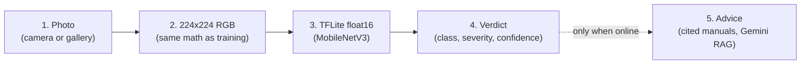
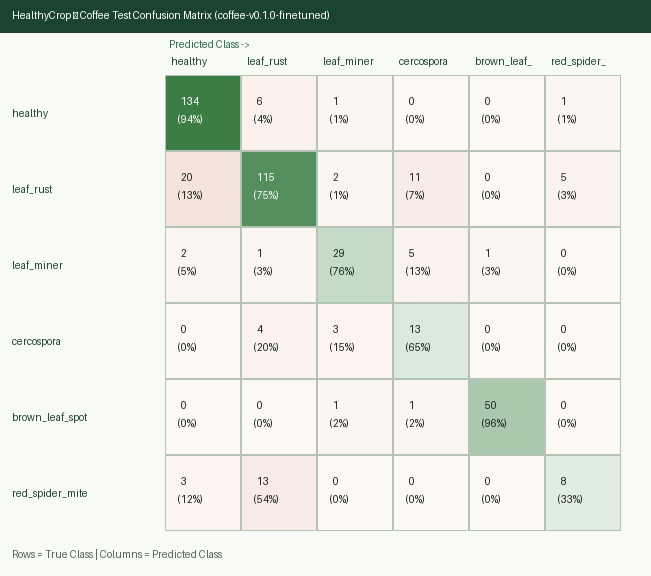
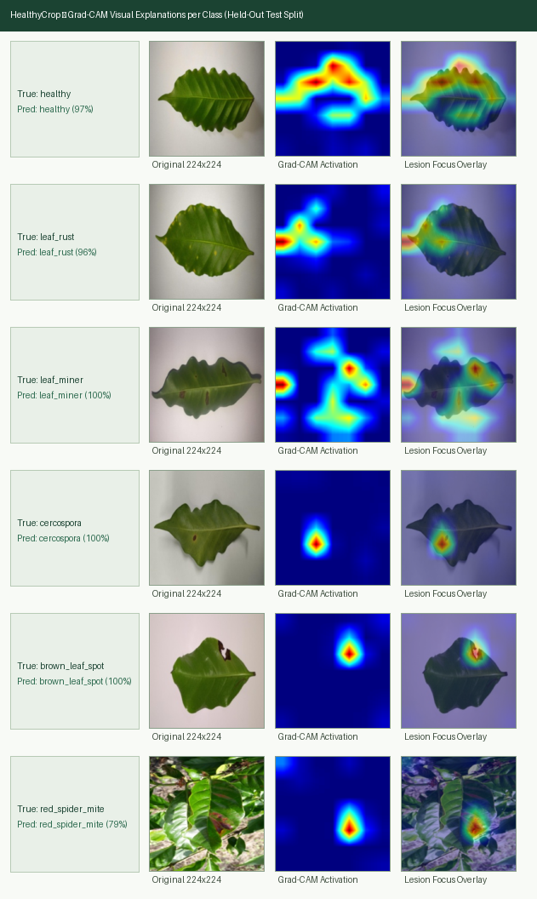
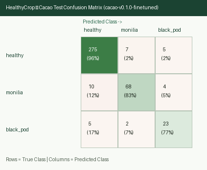
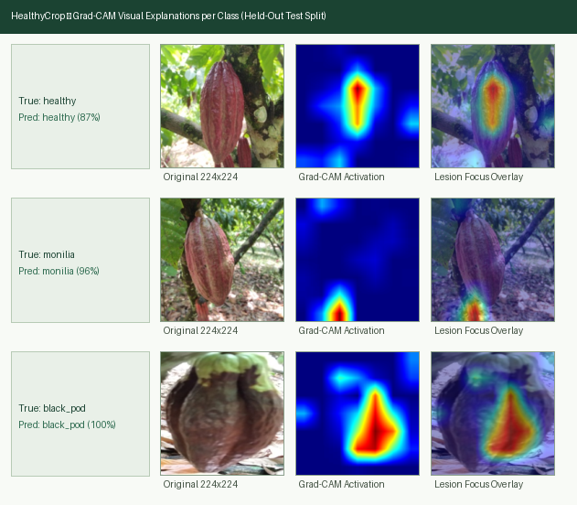
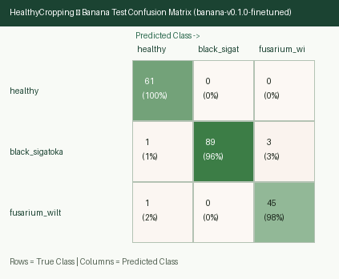
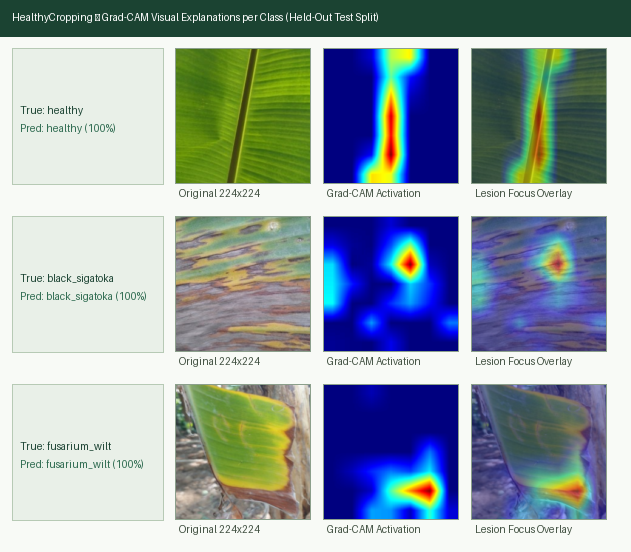

<p align="center">
  <a href="https://github.com/keylorpineda/healthycropping/releases"></a>
  <a href="docs/MODEL_CARD.md"></a>
  <a href="docs/DATASETS.md"></a>
  <a href="docs/FIELD_VALIDATION.md"></a>
  <a href="docs/SETUP_SERVICES_ES.md"></a>
</p>

<picture>
  <source media="(prefers-color-scheme: dark)" srcset="docs/assets/readme/card-dark.svg">
  
</picture>

<p align="center">
  <a href="https://github.com/keylorpineda/healthycropping/actions/workflows/ci.yml"></a>
  <a href="LICENSE"></a>
</p>

<details>
<summary><b>Read this page as text</b></summary>

## HealthyCropping

> [!NOTE]
> **In active development.** There is no installable APK yet: the first signed APK is planned for `v1.0.0`, after field validation. Today the app can be built from source (see [Run locally](#run-locally)).

Smallholder and medium-scale producers of coffee (*Coffea arabica*), cacao (*Theobroma cacao*) and banana (*Musa* spp.) in Costa Rica often work in mountain or rural plots with weak or no mobile signal. Spotting diseases early, such as coffee leaf rust (*Hemileia vastatrix*), cacao frosty pod rot (*Moniliophthora roreri*) or banana black Sigatoka (*Pseudocercospora fijiensis*), matters for timing controls, yet cloud-only tools fail when the connection drops.

**HealthyCropping** (`com.keylorpineda.healthycropping`) is an open-source, non-commercial, offline-first Android app. It runs float16 TensorFlow Lite models on the phone and keeps scans, farms and plots in SQLite, so diagnosis works without a signal. When online, an optional account syncs data through a FastAPI backend, and a Gemini RAG layer explains the result with citations from official manuals (ICAFE, CATIE, CORBANA).

> **Agronomic disclaimer**: HealthyCropping supports field decisions and **does not replace a certified agronomist or phytosanitary laboratory**. Always consult an agricultural professional before applying agrochemicals or removing plants.

### At a glance

| | |
| :--- | :--- |
| Crops | 3 (coffee, cacao, banana), one model each |
| Classes | 12 health and disease classes in total |
| Model | `MobileNetV3-Large`, `224x224` RGB, float16 TFLite, about `6.1 MB` each |
| Network calls to diagnose | 0 |

### How a scan works



1. **Crop selection**: the user picks coffee (leaf underside), cacao (pod) or banana (leaf) so the right model runs.
2. **Preprocessing**: the photo is resized to `224x224`, decoded to RGB and normalized exactly as in training. A shared fixture test proves the Python and React Native tensors match.
3. **On-device inference** with `react-native-fast-tflite`.
4. **Verdict**: if confidence is under the crop's calibrated threshold, the app asks for a new photo instead of guessing. Otherwise it shows the class, severity, confidence and one of `healthy`, `watch` or `act now`.
5. **Advice (optional, online)**: the backend retrieves passages from official manuals and Gemini explains next steps, citing source and section, and declines when the manuals do not cover the case. Explanations are stored for offline re-reading.

### The models

Numbers are for the exported float16 TFLite models on held-out test splits of public datasets. Real-field accuracy in Costa Rica is measured in Phase 8.

| Crop | Organ | Classes | Test accuracy | Test macro-F1 | Threshold | Documentation |
| :--- | :--- | :--- | :---: | :---: | :---: | :--- |
| **Coffee** | Leaf (underside) | `healthy`, `leaf_rust`, `leaf_miner`, `cercospora`, `brown_leaf_spot`, `red_spider_mite` | `81.1%` | `0.72` | `0.79` | [Model card](docs/MODEL_CARD.md#2-coffee-leaf-model-coffee) |
| **Cacao** | Pod | `healthy`, `monilia`, `black_pod` | `91.7%` | `0.85` | `0.51` | [Model card](docs/MODEL_CARD.md#3-cacao-pod-model-cacao) |
| **Banana** | Leaf | `healthy`, `black_sigatoka`, `fusarium_wilt` | `97.5%` | `0.97` | `0.80` | [Model card](docs/MODEL_CARD.md#4-banana-leaf-model-banana) |

Coffee is under the `0.80` macro-F1 target: `cercospora` and `red_spider_mite` have about 20 test leaves each, so one leaf moves their F1 by several points. The analysis and every run, including failed attempts, are in [`docs/EXPERIMENTS.md`](docs/EXPERIMENTS.md).

| Crop | Confusion matrix (fine-tuned) | Grad-CAM |
| :--- | :--- | :--- |
| Coffee |  |  |
| Cacao |  |  |
| Banana |  |  |

### The verdict

| Stamp | Meaning |
| :--- | :--- |
| `healthy` | No action needed |
| `watch` | Early or mild signs |
| `act now` | Treat, or call a technician |
| `retake` | Confidence under the threshold; take a new photo |

### Where the project stands

Work follows the phases in [`docs/PLAN.md`](docs/PLAN.md):

| Phase | Milestone | Scope | Status |
| :--- | :--- | :--- | :--- |
| 0 | `v0.1.0` | Repository setup, community standards, CI | Done |
| 1 | `v0.1.0` | Coffee datasets, leakage-free split, baseline | Done |
| 2 | `v0.1.0` | Coffee fine-tuning, float16 export, preprocessing fixture | Done |
| 3 | `v0.2.0` | App shell, design system, onboarding, home, settings | Done |
| 4 | `v0.2.0` | Camera, on-device inference, result screen, offline history | Done |
| 5 | `v0.3.0` | Cacao and banana models, all three crops in the app | Done; on-device check pending |
| 6 | `v0.4.0` | FastAPI, Firebase auth, farm/plot/scan sync | Done |
| 7 | `v0.5.0` | Gemini RAG explanations with cited sources | Done |
| 8 | `v1.0.0` | Field validation, benchmarks, signed APK release | In progress |

Next: plot maps, disease hotspots and weather risk alerts (`v1.1.0`), then Sentinel-2 NDVI and one more Costa Rican crop (`v1.2.0`).

### What is inside

```text
healthycropping/
├── app/       # Expo React Native (Android, pnpm): on-device TFLite, SQLite, UI
├── api/       # Python 3.12 (uv): FastAPI, Firebase Admin, Cloudinary, RAG, weather
├── ml/        # Python 3.12 (uv): data, training, evaluation, TFLite export
└── docs/      # PLAN, ARCHITECTURE, DATASETS, MODEL_CARD, EXPERIMENTS, DEVLOG
```

| Workspace | Stack | Purpose |
| :--- | :--- | :--- |
| [`app/`](app/README.md) | React Native 0.76, Expo 52, TypeScript, SQLite, TFLite | Offline Android app |
| `api/` | Python 3.12, FastAPI, Firebase Admin, Cloudinary, Gemini | Token verification, sync, RAG advice, weather risk |
| `ml/` | Python 3.12, TensorFlow 2.18+, Pillow | Training, evaluation and float16 export |

The phone never talks to Firestore: it sends Firebase ID tokens to `api/`, and the Firestore rules deny all client access.

### Run locally

Prerequisites: Node.js 20+ and `pnpm` for the app (never `npm` or `yarn`), the Android SDK, Python 3.12 and `uv` for `api/` and `ml/`. Step-by-step service setup (Spanish): [`docs/SETUP_SERVICES_ES.md`](docs/SETUP_SERVICES_ES.md).

```bash
cd app && pnpm install && pnpm lint && pnpm typecheck && pnpm test && pnpm start
```

```bash
cd api && uv sync --all-extras && uv run pytest && uv run uvicorn healthycropping_api.main:app --reload
```

```bash
cd ml && uv sync --all-extras && uv run ruff check . && uv run mypy src scripts tests && uv run pytest
```

The card above is generated from the model registries; rebuild it after a model or status change:

```bash
cd ml && uv run python scripts/build_readme_card.py
```

### Open Source Contributions & Community

Contributions are welcome. Please check our open issues and guidelines before opening a pull request:

- **Roadmap & Tasks**: https://github.com/keylorpineda/healthycropping/issues
- **Community Spotlight**: [GitHub Discussions Announcement](https://github.com/community/community/discussions/137746#discussioncomment-19118448)
- **Contributing Guidelines**: [`CONTRIBUTING.md`](CONTRIBUTING.md)
- **Architecture Overview**: [`docs/ARCHITECTURE.md`](docs/ARCHITECTURE.md)
- **Code of Conduct**: [`CODE_OF_CONDUCT.md`](CODE_OF_CONDUCT.md)

---

### Limitations

1. **Decision Support Only**: Visual symptoms cannot distinguish every microscopic pathogen strain or nutrient deficiency. Laboratory diagnostics remain necessary for high-impact interventions.
2. **Field Lighting Sensitivity**: Direct specular glare on wet foliage or extreme motion blur can reduce model confidence.
3. **Backend Cold Starts**: The optional FastAPI API runs on Render's free tier, which sleeps after 15 minutes of inactivity. Disease diagnosis and SQLite storage run fully offline on the phone and do not depend on it.
4. **Public Training Data**: Models are trained on public datasets whose cameras, cultivars and backgrounds differ from Costa Rican farms; real-field accuracy is unmeasured until field validation (Phase 8).

---

### Dataset Credits & Licenses

The MIT license in [`LICENSE`](LICENSE) applies **solely to the source code** in this repository. Training datasets remain under their respective upstream licenses documented in [`docs/DATASETS.md`](docs/DATASETS.md):

- **RoCoLe** (Coffee — Mendeley Data, DOI [`10.17632/c5yvn32dzg.2`](https://doi.org/10.17632/c5yvn32dzg.2))
- **BRACOL** (Coffee — Mendeley Data, DOI [`10.17632/yy2k5y8mxg.1`](https://doi.org/10.17632/yy2k5y8mxg.1))
- **CocoaMoniliaDataSet** (Cacao — Zenodo, DOI [`10.5281/zenodo.17156051`](https://doi.org/10.5281/zenodo.17156051), CC BY 4.0)
- **UNAB Cocoa Diseases** (Cacao — Kaggle `serranosebas/enfermedades-cacao-yolov4`)
- **Banana Leaves Imagery** (Banana — NM-AIST DSpace [`20.500.12479/3003`](https://dspace.nm-aist.ac.tz/handle/20.500.12479/3003); DOI [`10.1038/s41597-025-04456-4`](https://doi.org/10.1038/s41597-025-04456-4))
- **BananaLSD** (Banana — Mendeley Data, DOI [`10.17632/9tb7k297ff.1`](https://doi.org/10.17632/9tb7k297ff.1))

---

### Non-Commercial Distribution Note

**HealthyCropping** (`com.keylorpineda.healthycropping`) is strictly non-commercial. Starting with `v1.0.0`, it will be distributed free of charge as an installable Android `.apk` exclusively through [GitHub Releases](https://github.com/keylorpineda/healthycropping/releases), with no advertisements or paid subscriptions. Until then, releases only include the exported `.tflite` models.

---

### How to Cite

```bibtex
@software{pineda2026healthycropping,
  author       = {Pineda, Keylor},
  title        = {{HealthyCropping: Offline-First Crop Disease Detection for Coffee, Cacao, and Banana}},
  year         = {2026},
  url          = {https://github.com/keylorpineda/healthycropping},
  version      = {0.1.0},
  license      = {MIT}
}
```

---

### Author & Maintainers

- **Keylor Pineda** — [@keylorpineda](https://github.com/keylorpineda)
- **Jefferson Abarca** — [@JAbarca74](https://github.com/JAbarca74)

</details>
