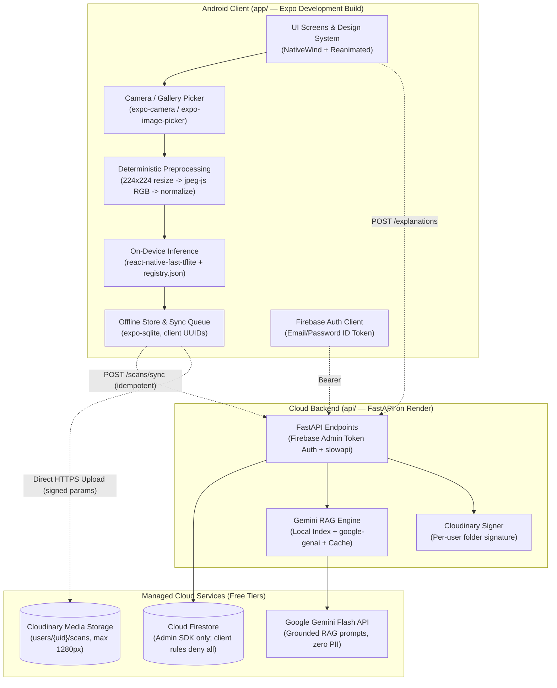

# HealthyCrop — Architecture & Technical Design

## 1. System Overview

**HealthyCrop** (`com.keylorpineda.healthycrop`) is an offline-first Android decision-support system for smallholder farmers and field technicians in Costa Rica. Every core diagnostic workflow runs on the device without requiring network connectivity or a user account. Optional cloud features (multi-device farm/plot/scan synchronization, cloud photo backup, and retrieval-augmented agronomic explanations) are mediated exclusively through a stateless FastAPI backend (`api/`).



---

## 2. Monorepo Structure

```text
healthycrop/
├── AGENTS.md                   # Engineering rules and workflow (< 4,000 chars)
├── .github/                    # Workflows (ci.yml, release.yml), templates, CODEOWNERS, dependabot
├── ml/                         # Python 3.12 (uv) — Dataset pipeline, training, evaluation, TFLite export
│   ├── configs/                # Per-crop YAML configs (coffee.yaml, cacao.yaml, banana.yaml)
│   ├── scripts/                # Idempotent download_<dataset>.py and prepare_<crop>.py scripts
│   ├── notebooks/              # Google Colab training notebooks (1:1 parity with ml/src/)
│   ├── src/                    # Reusable library: preprocessing, deduplication, split, train, eval, export
│   ├── models/                 # Per-crop registry.json metadata (weights ignored in Git)
│   └── tests/                  # Pytest unit tests + shared preprocessing fixture generator
├── api/                        # Python 3.12 (uv) — FastAPI backend
│   ├── scripts/                # build_rag_index.py for official agronomic manuals
│   ├── src/healthycrop_api/    # Routers, Pydantic v2 models, Firebase Admin auth, Firestore, RAG
│   └── tests/                  # Pytest + httpx suites including multi-tenant isolation tests
├── app/                        # Expo React Native (Android, pnpm)
│   └── src/
│       ├── app/                # Expo Router file-based navigation screens
│       ├── components/ui/      # Reusable design system primitives (no one-off styles)
│       ├── db/                 # expo-sqlite schema, migrations, repositories, sync engine
│       ├── i18n/               # i18next locales (es default, en secondary)
│       ├── ml/                 # Image resize, jpeg-js decode, tensor normalization, TFLite runner
│       ├── services/           # API client, Firebase Auth wrapper, Cloudinary uploader
│       ├── store/              # Zustand state stores
│       └── theme/              # Design tokens (colors, typography, spacing, radii, elevation, motion)
└── docs/                       # Project plans, reports, model cards, devlog, and Spanish setup guide
```

---

## 3. Machine Learning & On-Device Inference Pipeline

### 3.1 One-Model-Per-Crop Architecture
Rather than training a single multi-crop classifier where cross-crop visual similarities (e.g., necrotic spots on coffee vs. banana leaves) degrade precision, the user selects the target crop (**Coffee**, **Cacao**, or **Banana**) before scanning, and the app loads the corresponding float16 `.tflite` model (`< 10 MB` each) defined in `registry.json`.

| Crop | Target Organ | Classes | Architecture | Input |
| :--- | :--- | :--- | :--- | :--- |
| **Coffee** | Leaf (underside preferred) | `healthy`, `leaf_rust` (+ severity), `leaf_miner`, `cercospora`, `brown_leaf_spot`, `red_spider_mite` | `MobileNetV3-Large` | `224x224x3` RGB |
| **Cacao** | Pod (fruit) | `healthy`, `monilia` (stages), `black_pod` (*Phytophthora*) | `MobileNetV3-Large` | `224x224x3` RGB |
| **Banana** | Leaf | `healthy`, `black_sigatoka`, `fusarium_wilt` | `MobileNetV3-Large` | `224x224x3` RGB |

### 3.2 Deterministic Cross-Platform Preprocessing
To prevent train/serve skew between Python (`Pillow` / `TensorFlow`) and React Native (`app/src/ml/`), both environments implement the exact same pipeline:
1. **EXIF Orientation & Center/Resize**: Normalize orientation and resize to `224x224`.
2. **RGB Byte Extraction**: Decode JPEG into contiguous `Uint8` RGB channel order (`[R, G, B]`, dropping alpha if RGBA from `jpeg-js`).
3. **Normalization**: Convert `Uint8` `[0, 255]` to `Float32` using the normalization parameters recorded in the crop's `registry.json`.
4. **Shared Fixture Verification**: `ml/tests/` generates a canonical test image + expected `Float32` tensor JSON fixture, and `app/src/ml/__tests__/` asserts element-wise equality against that fixture.

---

## 4. Offline-First Storage & Synchronization (`expo-sqlite`)

- **Local Tables**:
  - `farms`: `id` (client UUID v4), `name`, `region`, `altitude_m`, `created_at`, `updated_at`, `deleted_at`, `sync_status` (`pending` | `synced` | `failed`).
  - `plots`: `id` (client UUID v4), `farm_id`, `name`, `crop`, `area_ha`, `created_at`, `updated_at`, `deleted_at`, `sync_status`.
  - `scans`: `id` (client UUID v4), `farm_id` (nullable), `plot_id` (nullable), `crop`, `predicted_class`, `severity`, `confidence`, `status` (`healthy` | `watch` | `act_now`), `model_version`, `local_photo_uri`, `cloudinary_public_id` (nullable), `explanation_json` (nullable), `scanned_at`, `updated_at`, `deleted_at`, `sync_status`.
- **Idempotent Sync**:
  - Every entity is assigned a deterministic client-generated UUID v4 at creation time.
  - `POST /scans/sync` upserts records keyed by `(ownerUid, client_uuid)` so retrying a batch request after a dropped rural mobile connection never creates duplicate records.

---

## 5. Security & Data Boundaries

1. **Zero Direct Firestore Access from the App**:
   - The Android client uses Firebase Auth strictly to obtain an authenticated `idToken`.
   - `firestore.rules` denies all client reads and writes (`allow read, write: if false;`).
   - All data operations go through `api/` using the Firebase Admin SDK, where every Firestore document stores `ownerUid` and every query filters by the verified caller `uid`.
2. **Signed Cloudinary Uploads**:
   - The client requests short-lived signed upload parameters from `api/`, resizes the photo locally to a maximum dimension of `1280 px`, uploads directly to `users/{uid}/scans/`, and sends only the resulting `public_id` to `api/`.
3. **Privacy-Preserving RAG (`POST /explanations`)**:
   - Prompts to Gemini include only `(crop, predicted_class, severity, language)` and retrieved passages from official technical manuals (e.g., ICAFE).
   - User names, email addresses, farm names, and coordinates are never included in LLM prompts.
   - Responses are cached by `(crop, class, severity, language)` and rate-limited to `20 requests/user/hour`.

---

## 6. Pinned Toolchain & SDK Matrix

*(Updated as native modules are installed in Phase 3 and Phase 4)*

| Layer | Package / Tool | Version / Pin Policy | Notes |
| :--- | :--- | :--- | :--- |
| **Node.js** | Node LTS | `24.18.0` (`.nvmrc`) | Pinned for local dev and GitHub Actions |
| **Package Manager (JS)** | `pnpm` | `11.17.0` (`packageManager`) | Configured with `node-linker=hoisted` in `.npmrc` |
| **Package Manager (Py)** | `uv` | `>=0.6` (`Python 3.12`) | Independent lockfiles in `api/uv.lock` and `ml/uv.lock` |
| **App Framework** | Expo SDK (Dev Build) | `expo@~52.0.49` | Managed workflow with custom native build (`com.keylorpineda.healthycrop`) |
| **React & React Native** | React / React Native | `react@18.3.1`, `react-native@0.76.7` | New Architecture enabled (`newArchEnabled: true`) |
| **Navigation & Routing** | Expo Router | `expo-router@~4.0.22` | File-based routing rooted at `src/app` |
| **Animation & Gestures** | Reanimated / Gestures | `react-native-reanimated@~3.16.7`, `react-native-gesture-handler@~2.20.2` | 60/120 fps native driver interactions |
| **Native UI Primitives** | Screens / Safe Area | `react-native-screens@~4.4.0`, `react-native-safe-area-context@4.12.0` | Native fragment containers and inset handling |
| **Hardware & Media** | Haptics / Image / Locale | `expo-haptics@~14.0.1`, `expo-image@~2.0.7`, `expo-localization@~16.0.1` | Tactile feedback, SDWebImage/Glide caching, system locale detection |
| **State Management** | Zustand | `zustand@^5.0.15` | Lightweight reactive store for preferences and app state |
| **Internationalization** | i18next / react-i18next | `i18next@^24.2.3`, `react-i18next@^15.7.4` | Spanish (`es`) default, English (`en`) secondary |
| **Testing** | Jest / Testing Library | `jest-expo@~52.0.6`, `@testing-library/react-native@^13.3.3` | Unit and component testing with native mocks |
| **Camera & Capture** | `expo-camera`, `expo-image-picker` | `expo-camera@~16.0.18`, `expo-image-picker@~16.0.6` | Custom camera viewfinder with framing guide, shutter haptics, and gallery picker fallback |
| **Image Manipulation** | `expo-image-manipulator` | `expo-image-manipulator@~13.0.6` | 224x224 RGB image resizing and cropping for on-device inference |
| **Image Decoding** | `jpeg-js` | `jpeg-js@^0.4.4` | Raw RGB pixel decoding from compressed JPEG byte buffers |
| **On-Device ML** | `react-native-fast-tflite` | `react-native-fast-tflite@1.6.1` | Zero-copy JSI Float32Array TFLite model execution |
| **Local Database** | `expo-sqlite`, `expo-crypto` | `expo-sqlite@~15.1.2`, `expo-crypto@~14.0.2` | Offline persistence for farms, plots, scans, and sync queue with client UUID v4 |
| **Backend Framework** | `fastapi` + `pydantic` | `fastapi >=0.115`, `pydantic >=2.10` | Hosted on Render free tier (documenting ~30–50s cold starts) |
