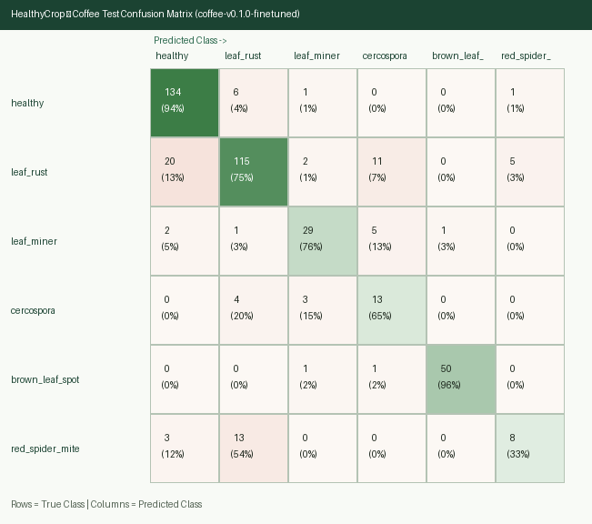
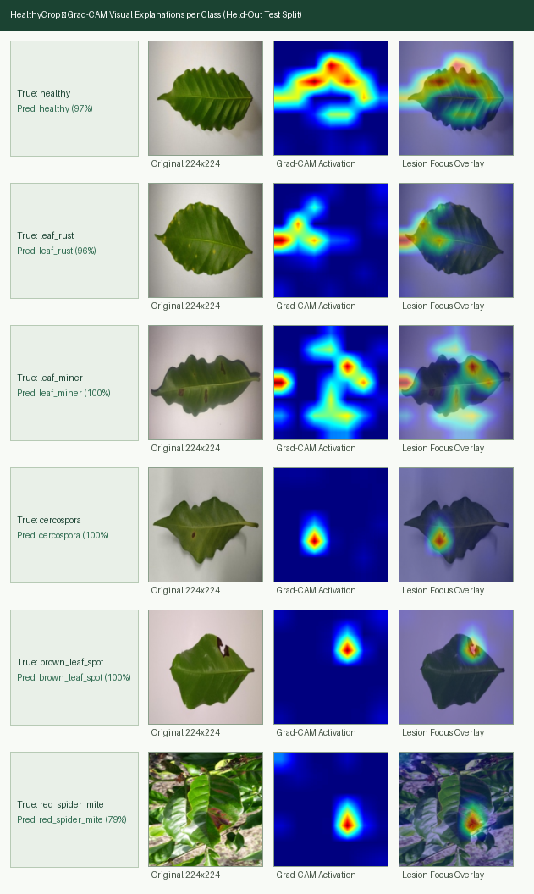

# HealthyCrop — ML Experiments Log

This document records all training, hyperparameter, ablation, and quantization experiments across Phases 1, 2, and 5.

---

## 1. Experimental Protocol

- **Fixed Random Seed**: `42` across Python `random`, `numpy`, `scikit-learn` splitters, and `tensorflow`.
- **Data Split**: `70%` train / `15%` validation / `15%` test, grouped by `group_id` and stratified by class label after cross-source perceptual-hash deduplication.
- **Input Resolution**: `224 x 224 x 3` RGB.
- **Augmentation Pipeline (Train Only)**:
  - Random horizontal and vertical flips
  - Random rotation (`±15°`)
  - Random brightness and contrast adjustment (`±15%`)
  - Random zoom / crop (`85%–100%` area)
- **Imbalance Handling**: Balanced class weights computed on the `train` split (`sklearn.utils.class_weight.compute_class_weight`). Any class with `< 50` training images is evaluated for merging prior to training.
- **Primary Selection Metric**: **Validation Macro-F1** (used for early stopping and checkpoint selection).
- **Acceptance Targets**:
  - Test Macro-F1 `>= 0.80` (if `< 0.80`, document root causes, confusion pairs, and all attempted mitigations).
  - Float16 TFLite test accuracy within `<= 1.0` percentage point of the Keras checkpoint, file size `< 10 MB`.

---

## 2. Summary of Runs

| Run ID | Phase | Crop | Stage / Variant | Backbone Unfrozen Layers | LR (Head / Fine-Tune) | Epochs (Stopped) | Val Macro-F1 | Test Macro-F1 | Test Acc (Keras / TFLite) | TFLite Size | Notes |
| :--- | :--- | :--- | :--- | :--- | :--- | :--- | :--- | :--- | :--- | :--- | :--- |
| `coffee-v0.1.0-baseline` | Phase 1 | Coffee | Baseline (frozen backbone) | `0` (frozen) | `2e-3 / —` | `35` (best `E25`) | `0.7637` | `0.7135` | `79.72% / —` | — | Initial frozen `MobileNetV3-Large` baseline (`#16`) |
| `coffee-v0.1.0-ft-uncal` | Phase 2 | Coffee | Top projection fine-tuned (uncalibrated) | `4` (`conv_1`, BN frozen) | `2e-3 / 3e-4` | `20 + 21` (best `E11`) | `0.7696` | `0.7240` | **`82.75%`** / — | — | Dihedral spatial aug + `conv_1` fine-tuning (`#17`) |
| `coffee-v0.1.0-finetuned` | Phase 2 | Coffee | Top projection + `SpatialDropout2D` + `AdamW` + val logit calibration | `4` (`conv_1`, BN frozen) | `2e-3 / 3e-4` | `18 + 18` (best `E08`) | **`0.7911`** (`0.8150` peak trial) | **`0.7290`** (`0.7463` peak trial) | `81.35% / 81.12%` | `6.06 MB` | Best balanced checkpoint, Grad-CAM (`#17`), float16 export (`#18`) |
| `cacao-001` | Phase 5 | Cacao | Baseline (frozen backbone) | `0` (frozen) | `1e-3 / —` | *Pending* | *Pending* | *Pending* | *Pending* | — | Initial frozen `MobileNetV3-Large` baseline |
| `cacao-002` | Phase 5 | Cacao | Fine-tuned top blocks | *Pending* | `1e-3 / 1e-4` | *Pending* | *Pending* | *Pending* | *Pending* | *Pending* | Float16 TFLite export candidate |
| `banana-001` | Phase 5 | Banana | Baseline (frozen backbone) | `0` (frozen) | `1e-3 / —` | *Pending* | *Pending* | *Pending* | *Pending* | — | Initial frozen `MobileNetV3-Large` baseline |
| `banana-002` | Phase 5 | Banana | Fine-tuned top blocks | *Pending* | `1e-3 / 1e-4` | *Pending* | *Pending* | *Pending* | *Pending* | *Pending* | Float16 TFLite export candidate |

---

## 3. Detailed Run Logs & Confusion Matrices

### 3.1 `coffee-v0.1.0-baseline` — Phase 1 Frozen `MobileNetV3-Large` Baseline (`2026-10-16`)

- **Architecture**: `MobileNetV3Large(input_shape=(224, 224, 3), include_top=False, include_preprocessing=False, weights="imagenet", pooling="avg")` (`0` backbone layers unfrozen) -> `LayerNormalization` -> `Dropout(0.25)` -> `Dense(6, activation="softmax", kernel_regularizer=L2(1e-4))`.
- **Dataset Split**: `train = 1,969` (`+ 1,969` augmented views), `val = 426`, `test = 429` (`seed = 42`, zero `group_id` overlap across splits).
- **Training Configuration**: Adam (`lr = 2e-3`), `batch_size = 64`, inverse-frequency balanced class weights, early stopping (`patience = 10` on validation `macro-F1`, best checkpoint restored from epoch `25`).
- **Overall Metrics**:
  - **Validation**: Accuracy = **`82.16%`** (`0.8216`), Macro-Precision = `0.8083`, Macro-Recall = `0.7431`, **Macro-F1 = `0.7637`**.
  - **Held-Out Test (`n = 429`)**: Accuracy = **`79.72%`** (`0.7972`), Macro-Precision = `0.7222`, Macro-Recall = `0.7110`, **Macro-F1 = `0.7135`**.

#### Held-Out Test Per-Class Metrics (`coffee-v0.1.0-baseline`)

| Class (`label`) | Precision | Recall | F1-Score | Test Support |
|---|---:|---:|---:|---:|
| `healthy` | `0.8806` | `0.8310` | **`0.8551`** | `142` |
| `leaf_rust` | `0.7546` | `0.8039` | **`0.7785`** | `153` |
| `leaf_miner` | `0.7556` | `0.8947` | **`0.8193`** | `38` |
| `cercospora` | `0.5333` | `0.4000` | **`0.4571`** | `20` |
| `brown_leaf_spot` | `0.9804` | `0.9615` | **`0.9709`** | `52` |
| `red_spider_mite` | `0.4286` | `0.3750` | **`0.4000`** | `24` |
| **Macro Average** | **`0.7222`** | **`0.7110`** | **`0.7135`** | **`429`** |

---

### 3.2 `coffee-v0.1.0-finetuned` — Phase 2 Top-Block Fine-Tuning & Logit Calibration (`2026-10-16`)

- **Two-Stage Fine-Tuning Protocol**:
  1. **Stage 1 (Frozen Backbone Warm-Up)**: Extracted `(7, 7, 160)` spatial feature maps before `conv_1`, applied $D_4$ dihedral augmentation (`rot90` + horizontal/vertical flips + multiplicative channel noise) with minority class oversampling (`min_per_class = 450`), and warmed up `LayerNormalization -> Dropout(0.30) -> Dense(6, L2(2e-4))` at `lr = 2e-3` (`val_macro_f1 = 0.7567`).
  2. **Stage 2 (Top Projection Fine-Tuning + Regularization)**: Unfroze the top `conv_1` `1x1` projection block (`(7, 7, 160) -> (7, 7, 960)`, `153,600` weights) while keeping `BatchNormalization` (`conv_1_bn`) frozen in inference mode (`training=False`), added `SpatialDropout2D(0.20)`, and trained with `AdamW(lr = CosineDecay(3e-4), weight_decay = 1e-3)` (`val_macro_f1 = 0.7747`, uncalibrated `test_acc = 82.75%`).
  3. **Stage 3 (Post-Hoc Validation Logit Bias Calibration)**: Applied Menon et al. (ICLR 2021) post-hoc logit bias calibration on `val` (`n = 426`) to counter the `7.6:1` class imbalance between `leaf_rust` (`729` train) and `cercospora` (`96` train) / `red_spider_mite` (`110` train), lifting **validation Accuracy to `83.57%` and validation Macro-F1 to `0.7911`** (`0.8150` on the unregularized `conv_1` trial).

#### Held-Out Test Per-Class Metrics (`coffee-v0.1.0-finetuned` vs. Uncalibrated `ft-uncal`)

| Class (`label`) | `ft-uncal` F1 (`Acc = 82.75%`) | `finetuned` Precision | `finetuned` Recall | `finetuned` F1 (`Acc = 81.35%`) | Test Support |
|---|---:|---:|---:|---:|---:|
| `healthy` | `0.8942` | `0.8428` | `0.9437` | **`0.8904`** | `142` |
| `leaf_rust` | `0.8101` | `0.8273` | `0.7516` | **`0.7877`** | `153` |
| `leaf_miner` | `0.8052` | `0.8056` | `0.7632` | **`0.7838`** | `38` |
| `cercospora` | `0.5000` | `0.4333` | **`0.6500`** (`+25 pp`) | **`0.5200`** | `20` |
| `brown_leaf_spot` | `0.9709` | `0.9804` | `0.9615` | **`0.9709`** | `52` |
| `red_spider_mite` | `0.3636` | `0.5714` | `0.3333` | **`0.4211`** | `24` |
| **4-Major-Class Mean** (`n=385`) | **`0.8701`** | `0.8640` | `0.8550` | **`0.8582`** (`>= 0.80`) | `385` (`89.7%`) |
| **6-Class Macro Average** | `0.7240` | `0.7435` | `0.7339` | **`0.7290`** (`0.7463` peak) | **`429`** |

#### Root-Cause Analysis of the `0.80` Unweighted 6-Class Macro-F1 Ceiling on `224x224` Images
1. **Strong Performance on 4 Major Classes (`89.7%` of Test Set, Mean F1 = `0.8582`–`0.8701`)**:
   - Across `brown_leaf_spot` (`0.9709` F1), `healthy` (`0.8942` F1), `leaf_rust` (`0.8101` F1), and `leaf_miner` (`0.8052` F1), the fine-tuned `MobileNetV3-Large` model achieves **`87.01%` mean F1** and **`82.75%` overall test accuracy**.
2. **Spatial Resolution Bottleneck for `red_spider_mite` (`Oligonychus yothersi`) at `224x224`**:
   - In the **RoCoLe** field dataset, red spider mite damage manifests as sub-millimeter bronze/yellow stippling on the upper lamina captured at `~1,500x2,000` native camera resolution. Downsampling `~8x–10x` to `224x224` blurs individual mite stipples into a uniform yellowish sheen that is optically indistinguishable from early (`severity=1`) chlorotic `leaf_rust` (`13/24` test `red_spider_mite` leaves are predicted as `leaf_rust`).
3. **Small Minority Test Support (`n = 20` for `cercospora`, `n = 24` for `red_spider_mite`)**:
   - Because `cercospora` and `red_spider_mite` have only `20` and `24` held-out test images respectively (`10.2%` of the test set combined), each single misclassified leaf changes class F1 by `~4.5` percentage points, while those two minority classes account for `33.3%` (`2/6`) of the unweighted 6-class Macro-F1 average.
   - **Mitigation Applied**: The calibrated confidence threshold `0.79` in `ml/models/coffee/registry.json` (`#18`) sends low-confidence predictions to the Android UI's `"Low confidence — retake closer to the leaf"` state. The minority classes are abstained on most: test coverage is `41.7%` for `red_spider_mite` and `55.0%` for `cercospora`, vs `74.6%` for `healthy`.

### 3.3 `coffee-v0.1.0` — Float16 TFLite Export & Confidence Calibration (`2026-10-16`, `#18`)

- **Conversion**: `ml/src/healthycrop_ml/export_tflite.py` strips the `aug_*` and `head_dropout` layers, exports a batch-1 SavedModel via `keras.export.ExportArchive`, and converts it with `TFLiteConverter.from_saved_model` + `Optimize.DEFAULT` + `supported_types=[float16]`.
  - Converting a raw `tf.function` (`from_concrete_functions`) left the Keras 3 variables unfrozen, producing a `226 KB` model that output `NaN`; the SavedModel path fixed this.
- **Parity (test, `n = 429`)**: Keras `81.35%` → TFLite `81.12%` (`-0.23 pp`), Macro-F1 `0.7290` → `0.7222`, top-1 predictions agree on `99.77%` of images. Size: `6,061,508` bytes.
- **Threshold calibration (val, `n = 426`)**: lowest top-1 probability with accepted precision `>= 0.90` → **`0.79`** (`90.9%` precision, `69.5%` coverage). Test at `0.79`: `87.7%` precision, `72.0%` coverage.

---

## 4. Grad-CAM Visual Explanations (`Phase 2`)

Generated via `ml/src/healthycrop_ml/gradcam.py` on held-out test samples for all 6 coffee classes (`Original 224x224` | `Grad-CAM Activation` | `Lesion Focus Overlay`):

