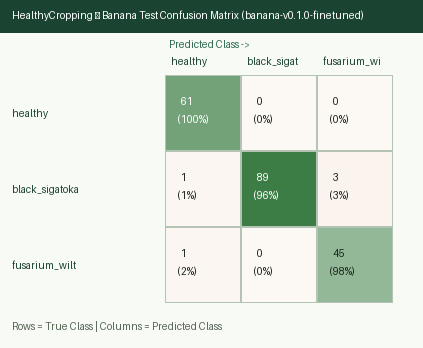
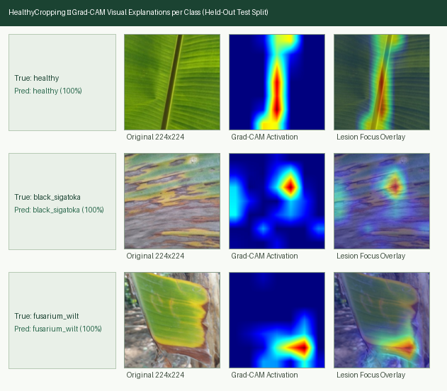

# HealthyCropping — Model Cards

This document provides the Model Cards (following Mitchell et al., 2019) for the three on-device TensorFlow Lite crop disease classification models shipped with **HealthyCropping**.

> [!WARNING]
> **Agronomic Decision-Support Disclaimer**: These models are intended solely for preliminary field decision support in Costa Rica and comparable tropical agroecosystems. They **do not replace a certified agronomist** or laboratory phytosanitary diagnosis. Visual symptoms of fungal, bacterial, viral, pest, and nutritional disorders can overlap. Never apply restricted agrochemicals or eradicate trees based solely on an automated prediction.

---

## 1. Shared Architecture & Export Specification

- **Developer / Author**: Keylor Pineda (`@keylorpineda`)
- **Backbone Architecture**: `MobileNetV3-Large` pretrained on ImageNet-1K (`include_top=False`), global average pooling, dropout, and crop-specific classification head.
- **Training Strategy**:
  1. **Stage 1 (Baseline / Head Warm-up)**: Freeze `MobileNetV3-Large` backbone; train classification head with class weights and online data augmentation (random horizontal/vertical flips, rotation, brightness/contrast jitter, crop/zoom).
  2. **Stage 2 (Fine-Tuning)**: Unfreeze top feature-extraction blocks at a reduced learning rate with early stopping monitored on **validation macro-F1**.
- **Input Specification**: `224 x 224 x 3` RGB tensor, EXIF-transposed before resize, normalized identically in Python (`ml/`) and React Native (`app/src/ml/`).
- **Export Target**: Float16 quantized `.tflite` (`< 10 MB` per model), verified within `<= 1.0` percentage point of Keras test accuracy.
- **Abstention / Low-Confidence Handling**: Each model defines a calibrated confidence threshold in `ml/models/<crop>/registry.json` selected on the validation split. Predictions below this threshold trigger the UI warning `"low confidence — retake the photo"` rather than an actionable diagnosis.

---

## 2. Coffee Leaf Model (`coffee`)

### 2.1 Overview
- **Model Identifier**: `coffee-v0.1.0` (training run `coffee-v0.1.0-finetuned`, `2026-10-16`)
- **Model File**: `coffee_v0.1.0_fp16.tflite` (`6,061,508` bytes, float16 weights, float32 I/O), attached to GitHub Releases (never committed)
- **Registry File**: [`ml/models/coffee/registry.json`](../ml/models/coffee/registry.json) (labels, input spec, normalization, confidence threshold, SHA-256, metrics)
- **Target Plant Organ**: Coffee leaf (*Coffea arabica* and *Coffea canephora*), one leaf filling most of the frame, underside preferred for early orange rust urediniospore detection.
- **Classes** (output order):
  1. `healthy`
  2. `leaf_rust` (*Hemileia vastatrix*)
  3. `leaf_miner` (*Leucoptera coffeella*)
  4. `cercospora` (*Cercospora coffeicola* / iron spot)
  5. `brown_leaf_spot` (*Phoma* / *Ascochyta* spp.)
  6. `red_spider_mite` (*Oligonychus yothersi*)
- **Severity**: `v0.1.0` predicts the class only. Rust severity labels (RoCoLe levels 1–4, BRACOL severity) are kept in the manifest for a later severity head; the app does not display a severity estimate yet.

### 2.2 Intended Use
- **Intended users**: Smallholder coffee farmers and extension workers in Costa Rica checking a suspicious leaf in the field, offline.
- **Intended use**: Preliminary triage that suggests the most likely visible condition and prompts consulting an agronomist or extension service before any treatment.
- **Out of scope**: Lab-grade diagnosis, treatment prescription, whole-plant or plot-level assessment, non-coffee plants, berries, stems, or roots.

### 2.3 Training & Evaluation Data
- **Sources**: RoCoLe (Mendeley DOI `10.17632/c5yvn32dzg.2`, Robusta field photos, CC BY 4.0) and the BRACOL whole-leaf subset (Mendeley DOI `10.17632/yy2k5y8mxg.1`, Arabica, CC BY 4.0). See [`docs/data_reports/coffee.md`](data_reports/coffee.md).
- **Preparation**: EXIF orientation fix, RGB, `224x224` bilinear resize, `imagehash.phash` deduplication (`78` cross-plant duplicates removed), `2,824` images total.
- **Split**: `70%` train (`1,969`) / `15%` validation (`426`) / `15%` test (`429`), grouped by plant (`group_id`), stratified by class (`seed=42`), zero group overlap across splits.
- **Preprocessing contract**: `normalized = (rgb - 127.5) / 127.5` (range `[-1, 1]`), NHWC float32. Parity with the app is enforced by [`ml/fixtures/preprocessing_fixture_224.json`](../ml/fixtures/preprocessing_fixture_224.json).

### 2.4 Quantitative Performance (held-out test split, `n = 429`)

| Metric | Keras Test Set | Float16 TFLite Test Set | Delta | Target |
| :--- | :--- | :--- | :--- | :--- |
| **Macro-F1 (6 classes)** | `0.7290` | `0.7222` | `-0.0068` | `>= 0.80` (not met, see §2.6) |
| **Mean F1 (4 major classes, `89.7%` of test)** | `0.8582` | `0.8556` | `-0.0026` | — |
| **Accuracy** | `81.35%` | `81.12%` | `-0.23 pp` | Within `1 pp` ✅ |
| **Keras / TFLite top-1 agreement** | — | `99.77%` | — | — |
| **Model Size** | `12.7 MB` (`.keras`) | `6.06 MB` | — | `< 10 MB` ✅ |
| **Confidence Threshold** | — | `0.79` | — | Validation-calibrated ✅ |

**Per-class float16 TFLite test metrics:**

| Class | Precision | Recall | F1 | Support | Coverage at threshold `0.79` |
| :--- | ---: | ---: | ---: | ---: | ---: |
| `healthy` | `0.8428` | `0.9437` | `0.8904` | `142` | `74.6%` |
| `leaf_rust` | `0.8273` | `0.7516` | `0.7877` | `153` | `66.0%` |
| `leaf_miner` | `0.7838` | `0.7632` | `0.7733` | `38` | `78.9%` |
| `cercospora` | `0.4138` | `0.6000` | `0.4898` | `20` | `55.0%` |
| `brown_leaf_spot` | `0.9804` | `0.9615` | `0.9709` | `52` | `98.1%` |
| `red_spider_mite` | `0.5714` | `0.3333` | `0.4211` | `24` | `41.7%` |

**Abstention**: the threshold is the lowest top-1 probability that keeps validation precision at `>= 90%` on accepted predictions (`90.9%` precision, `69.5%` coverage). On the test split, it gives `87.7%` precision at `72.0%` coverage. Below the threshold, the app shows "low confidence — retake the photo" instead of a diagnosis. The weakest classes (`red_spider_mite`, `cercospora`) are also the most often abstained on.

### 2.5 Interpretability (Grad-CAM)
- Per-class Grad-CAM grid: [`docs/assets/gradcam/coffee_gradcam.png`](assets/gradcam/coffee_gradcam.png). Correct predictions focus on lesions, pustules, and mines rather than background; full analysis in [`docs/EXPERIMENTS.md`](EXPERIMENTS.md#4-grad-cam-visual-explanations-phase-2).

### 2.6 Coffee-Specific Limitations
1. **Macro-F1 target not met (`0.72` vs `0.80`)**: driven by two small classes. `red_spider_mite` stippling blurs into early rust chlorosis at `224x224` (`13/24` test images predicted as `leaf_rust`); `cercospora` has only `96` training and `20` test images, and is often confused with `leaf_rust` (`11/153` rust images predicted as cercospora).
2. **Species/site bias**: RoCoLe is Robusta from a single region and BRACOL is Arabica from Brazil; no Costa Rican images were used for training. Field validation in Costa Rica is planned for `v1.0.0` (`docs/FIELD_VALIDATION.md`).
3. **Single label**: co-infections (e.g. rust + leaf miner) are reduced to the dominant visible pattern.
4. **Severity** is not estimated in `v0.1.0` (see §2.1).

---

## 3. Cacao Pod Model (`cacao`)

### 3.1 Overview
- **Target Plant Organ**: Cacao pod / fruit (*Theobroma cacao*) attached to tree or freshly harvested.
- **Model Identifier**: `cacao-v0.1.0` (`cacao_v0.1.0_fp16.tflite`, SHA-256 `c029ad5be683d98e98f7f73965102da97b7fa8f09b4500a36f743c480a9d4235`)
- **Registry File**: [`ml/models/cacao/registry.json`](../ml/models/cacao/registry.json)
- **Classes**:
  1. `healthy` (`h0` / `Sana`)
  2. `monilia` (*Moniliophthora roreri*, frost/internal rot stages `m1`, `m2`, `m3` / `Monilia`)
  3. `black_pod` (*Phytophthora palmivora* / *P. capsici*, `Fitoftora`)

### 3.2 Training & Evaluation Data
- **Sources**: **CocoaMoniliaDataSet** (Zenodo DOI `10.5281/zenodo.17156051`, CC BY 4.0) and **UNAB Cocoa Diseases** (Kaggle `serranosebas/enfermedades-cacao-yolov4`, ODbL v1.0, cropped per labeled YOLO bounding box with `5%` margin).
- **Split**: `2,646` deduplicated `224x224` RGB pod crops (`1,843` train / `404` validation / `399` test) across `1,367` distinct tree/photograph `group_id`s (`seed=42`, zero `group_id` overlap across splits; full report in [`docs/data_reports/cacao.md`](data_reports/cacao.md)).

### 3.3 Quantitative Performance (`n = 399` Held-Out Test Pods)

| Metric | Keras Test Set | Float16 TFLite Test Set | Delta | Target |
| :--- | :--- | :--- | :--- | :--- |
| **Macro-F1** | **`0.8502`** | **`0.8502`** | `0.0000` (`100.0%` top-1 agreement) | `>= 0.80` |
| **Accuracy** | **`91.73%`** (`366/399`) | **`91.73%`** (`366/399`) | **`0.00 pp`** | Within `<= 1.0 pp` |
| **Model Size** | `16.4 MB` (`.keras`) | **`6.06 MB`** (`6,055,744` B) | `-63.1%` | `< 10 MB` |
| **Confidence Threshold** | — | **`0.51`** (`90.15%` val precision, `91.73%` test precision at `100.0%` coverage) | — | Validation-calibrated (`>= 0.90` precision) |

#### Per-Class Held-Out Test Performance (`cacao_v0.1.0_fp16.tflite`)

| Class (`label`) | Precision | Recall | F1-Score | Test Support |
| :--- | ---: | ---: | ---: | ---: |
| `healthy` | `0.9483` | `0.9582` | **`0.9532`** | `287` |
| `monilia` | `0.8831` | `0.8293` | **`0.8553`** | `82` |
| `black_pod` | `0.7188` | `0.7667` | **`0.7419`** | `30` |
| **Macro Average** | **`0.8500`** | **`0.8514`** | **`0.8502`** | **`399`** |

### 3.4 Interpretability (Grad-CAM)
- Representative Grad-CAM heatmaps across `healthy`, `monilia`, and `black_pod` held-out test pods confirm localization onto white mycelial mats / chocolate spots (`monilia`) and dark necrotic pod lesions (`black_pod`):

---

## 4. Banana Leaf Model (`banana`)

### 4.1 Overview
- **Target Plant Organ**: Banana leaf (*Musa* spp.), field photographs.
- **Model Identifier**: `banana-v0.1.0` (`banana_v0.1.0_fp16.tflite`, SHA-256 `a7edfd8b60f0e48ceb06076f2ebb853b41f24d9c4065f55163957cbd2d20688f`)
- **Registry File**: [`ml/models/banana/registry.json`](../ml/models/banana/registry.json)
- **Classes**:
  1. `healthy`
  2. `black_sigatoka` (*Pseudocercospora fijiensis* / *Mycosphaerella fijiensis*)
  3. `fusarium_wilt` (*Fusarium oxysporum* f. sp. *cubense*)

### 4.2 Training & Evaluation Data
- **Sources**: **BananaLSD** (Mendeley `10.17632/9tb7k297ff.1`, CC BY 4.0, `OriginalSet` `healthy` and `sigatoka` only) and **Banana Imagery Dataset - Tanzania / NM-AIST** (Zenodo `10.5281/zenodo.7670326`, CC BY 4.0, first `300` `healthy`, `150` `black_sigatoka`, and `300` `fusarium_wilt` images extracted via HTTP Range).
- **Split**: `1,313` deduplicated `224x224` RGB images (`913` train / `200` validation / `200` test) across `770` `group_id`s (`seed=42`, zero `group_id` overlap; full report in [`docs/data_reports/banana.md`](data_reports/banana.md)).

### 4.3 Quantitative Performance (`n = 200` Held-Out Test Images)

| Metric | Keras Test Set | Float16 TFLite Test Set | Delta | Target |
| :--- | :--- | :--- | :--- | :--- |
| **Macro-F1** | **`0.9731`** | **`0.9731`** | `0.0000` (`100.0%` top-1 agreement) | `>= 0.80` |
| **Accuracy** | **`97.50%`** (`195/200`) | **`97.50%`** (`195/200`) | **`0.00 pp`** | Within `<= 1.0 pp` |
| **Model Size** | `12.7 MB` (`.keras`) | **`6.06 MB`** (`6,060,084` B) | `-52.3%` | `< 10 MB` |
| **Confidence Threshold** | — | **`0.80`** (`99.48%` val precision at `97.0%` coverage; `98.45%` test precision at `97.0%` coverage) | — | Validation-calibrated with a `0.80` floor |

#### Per-Class Held-Out Test Performance (`banana_v0.1.0_fp16.tflite`)

| Class (`label`) | Precision | Recall | F1-Score | Test Support |
| :--- | ---: | ---: | ---: | ---: |
| `healthy` | `0.9683` | `1.0000` | **`0.9839`** | `61` |
| `black_sigatoka` | `1.0000` | `0.9570` | **`0.9780`** | `93` |
| `fusarium_wilt` | `0.9375` | `0.9783` | **`0.9574`** | `46` |
| **Macro Average** | **`0.9686`** | **`0.9784`** | **`0.9731`** | **`200`** |

#### Per-Source Test Accuracy (`ml/scripts/evaluate_by_source.py`)

| Source | Test Images | Accuracy | `healthy` | `black_sigatoka` | `fusarium_wilt` |
| :--- | ---: | ---: | ---: | ---: | ---: |
| BananaLSD | `79` | `98.73%` | `10/10` | `68/69` | — |
| NM-AIST | `121` | `96.69%` | `51/51` | `21/24` | `45/46` |

- `fusarium_wilt` only exists in NM-AIST. Because NM-AIST `healthy` and `black_sigatoka` photos are classified correctly as well, the model is not separating classes by source alone; NM-AIST `black_sigatoka` (`87.5%` recall) is the weakest slice.

### 4.4 Interpretability (Grad-CAM)
- Held-out test heatmaps localize on streak lesions for `black_sigatoka` and on the chlorotic, necrotic leaf margin for `fusarium_wilt`; for `healthy` leaves activation follows the midrib:

### 4.5 Banana-Specific Limitations
- **Small, saturated validation set**: validation precision reaches `99.5%` at full coverage, so the precision-target calibration would pick a chance-level threshold (`0.30`). A `0.80` floor was applied (`--threshold-floor`), rejecting `3` of the `5` test errors while keeping `97%` coverage.
- **Single-source class**: `fusarium_wilt` images come from one Tanzanian field campaign; performance on Costa Rican cultivars and Fusarium wilt Tropical Race 4 symptoms is unverified until the Phase 8 field validation.
- **Leaf-level diagnosis only**: Fusarium wilt is a vascular disease; leaf yellowing is a late, non-specific symptom that can be confused with drought or nutrient stress. Pseudostem cross-section inspection by an agronomist is still required.

---

## 5. Known Limitations & Out-of-Scope Inputs

1. **Out-of-Distribution Inputs**: Scanning non-plant objects, stems/roots, unsupported crops, or multiple overlapping leaves degrades confidence and may trigger false positives if above the confidence threshold.
2. **Illumination & Moisture**: Specular glare from wet leaves/pods after tropical rain or harsh midday shadows can obscure chlorotic halos or early spore pustules.
3. **Co-Infections & Nutrient Deficiencies**: A single leaf may exhibit both fungal infection (e.g., *Cercospora*) and micronutrient deficiency (nitrogen/magnesium chlorosis); single-label classification predicts the dominant visual pattern.
