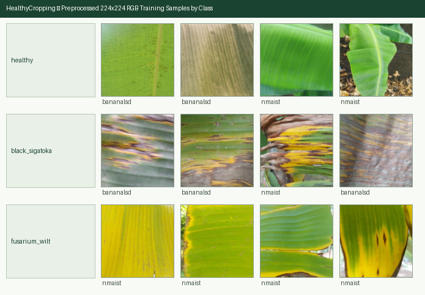

# Banana Leaf Disease Dataset Report (`Phase 5`)

## 1. Executive Summary

- **Target Crop**: Banana (*Musa* spp.)
- **Sources Combined**: **BananaLSD** (`10.17632/9tb7k297ff.1`, CC BY 4.0, `OriginalSet` only) + **NM-AIST Banana Leaves Imagery** (`10.5281/zenodo.7670326`, CC BY 4.0, Range-extracted subset)
- **Total Candidate Images**: `1352` (BananaLSD `602`, NM-AIST `750`)
- **Unmapped Classes Excluded** (BananaLSD `cordana`, `pestalotiopsis`): `335`
- **Unreadable / Corrupt Images Dropped**: `0`
- **Near-Duplicates Removed (`imagehash.phash`, Hamming distance <= `2`)**: `39`
- **Final Clean Preprocessed Images (`224x224` RGB)**: **`1313`** across **`770`** distinct `group_id`s
- **Zero `group_id` Overlap Across Splits (`train` / `val` / `test`)**: **`True`** (`seed=42`)

---

## 2. Per-Class Split & Source Distribution

| Class (`label`) | Train (`70%`) | Val (`15%`) | Test (`15%`) | Total Images | Distinct `group_id`s | BananaLSD | NM-AIST |
|---|---:|---:|---:|---:|---:|---:|---:|
| `healthy` | 271 | 59 | 61 | **391** | 173 | 91 | 300 |
| `black_sigatoka` | 436 | 93 | 93 | **622** | 514 | 472 | 150 |
| `fusarium_wilt` | 206 | 48 | 46 | **300** | 83 | 0 | 300 |
| **Total** | **913** | **200** | **200** | **1313** | **770** | **563** | **750** |

---

## 3. Taxonomy Mapping

| Target class | BananaLSD (`OriginalSet`) | NM-AIST archive |
|---|---|---|
| `healthy` | `healthy` | `HEALTHY-1.zip` |
| `black_sigatoka` | `sigatoka` | `BLACK SIGATOKA-2.zip` |
| `fusarium_wilt` | (not present) | `FUSARIUM WILT-1.zip` |

- BananaLSD `AugmentedSet` is excluded entirely: it contains synthetic augmentations of `OriginalSet` photos and would leak across splits.
- `fusarium_wilt` comes from a single source, so source and class are partially confounded; NM-AIST also contributes `healthy` and `black_sigatoka` to reduce this shortcut.

---

## 4. Small-Class Merging Evaluation (`< 50` Training Images Rule)

- **Minimum Training Image Threshold**: `50` images in `train`.
- **Classes Below Threshold**: **None (all 3 classes exceed 50 training images)**.

---

## 5. Perceptual-Hash Deduplication & Grouped Leakage Prevention

- Perceptual hashes (`imagehash.phash`, Hamming distance `<= 2`) removed **`39` duplicate samples** across sources.
- **NM-AIST Capture Grouping**: NM-AIST does not publish plant IDs; photos are numbered per capture session, so blocks of `10` consecutive numbers share one `group_id` (`nmaist_<label>_b<n // 10>`) to keep near-identical shots of a plant in one split.
- **BananaLSD**: no plant metadata is published; each photo is its own group.

---

## 6. Preprocessed Sample Grid (`224x224` RGB)

