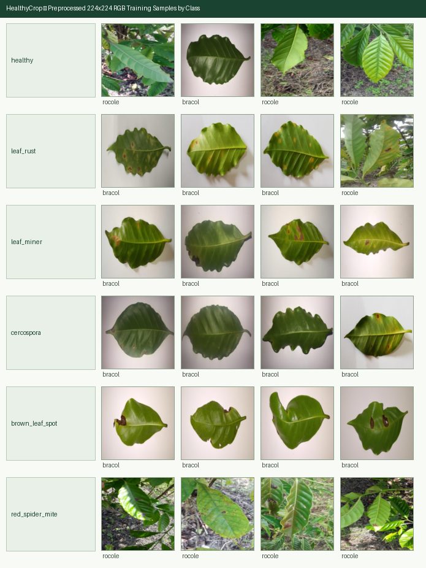

# Coffee Leaf Disease Dataset Report (`Phase 1`)

## 1. Executive Summary

- **Target Crop**: Coffee (*Coffea arabica* & *Coffea canephora* / Robusta)
- **Sources Combined**: **RoCoLe** (`10.17632/c5yvn32dzg.2`, CC BY 4.0) + **BRACOL** (`10.17632/yy2k5y8mxg.1`, CC BY 4.0, whole-leaf subset only)
- **Total Raw Annotation Rows Inspected**: `3245`
- **Undetermined Stress Rows Excluded (BRACOL code `5`)**: `62`
- **Unreadable / Missing Trailing Archive Entries Dropped**: `343` (from upstream truncated BRACOL archive)
- **Near-Duplicates Removed (`imagehash.phash`, Hamming distance <= `2`)**: `78`
- **Final Clean Preprocessed Images (`224x224` RGB)**: **`2824`** across **`1720`** distinct plant/leaf `group_id`s
- **Zero `group_id` Overlap Across Splits (`train` / `val` / `test`)**: **`True`** (`seed=42`)

---

## 2. Per-Class Split & Source Distribution

| Class (`label`) | Train (`70%`) | Val (`15%`) | Test (`15%`) | Total Images | Distinct `group_id`s | RoCoLe | BRACOL |
|---|---:|---:|---:|---:|---:|---:|---:|
| `healthy` | 616 | 138 | 142 | **896** | 512 | 754 | 142 |
| `leaf_rust` | 729 | 148 | 153 | **1030** | 782 | 566 | 464 |
| `leaf_miner` | 176 | 38 | 38 | **252** | 252 | 0 | 252 |
| `cercospora` | 96 | 20 | 20 | **136** | 136 | 0 | 136 |
| `brown_leaf_spot` | 242 | 52 | 52 | **346** | 346 | 0 | 346 |
| `red_spider_mite` | 110 | 30 | 24 | **164** | 119 | 164 | 0 |
| **Total** | **1969** | **426** | **429** | **2824** | **1720** | **1484** | **1340** |

---

## 3. Leaf Rust Severity Distribution (`severity` Metadata)

Both RoCoLe (`rust_level_1`-`rust_level_4`) and BRACOL (`severity` `1`-`4` when `predominant_stress == 2`) provide ordinal severity annotations for coffee leaf rust (*Hemileia vastatrix*):

| Leaf Rust Severity Level | Train | Val | Test | Total |
|---|---:|---:|---:|---:|
| Severity `1` | 429 | 86 | 89 | **604** |
| Severity `2` | 195 | 37 | 46 | **278** |
| Severity `3` | 63 | 14 | 12 | **89** |
| Severity `4` | 42 | 11 | 6 | **59** |

---

## 4. Small-Class Merging Evaluation (`< 50` Training Images Rule)

- **Minimum Training Image Threshold**: `50` images in `train` split.
- **Primary Classes Below Threshold**: **None (all 6 primary classes exceed 50 training images)**.
- **Smallest Primary Class**: `cercospora` has **`96` training images** (`136` total), comfortably above the `50`-image minimum threshold.
- **Severity Consolidation Decision (`leaf_rust`)**:
  - In raw annotations, `leaf_rust` is subdivided into 4 ordinal severity levels (`1`-`4`). However, **`severity=4` has only `40` training images** (`57` total across both datasets combined), which falls **below** the `50`-image minimum threshold.
  - Furthermore, visual boundaries between adjacent ordinal rust percentages (e.g., level 2 vs. level 3) are continuous rather than discrete pathologies.
  - **Decision**: Consolidate `rust_level_1`-`rust_level_4` into the single primary diagnostic class **`leaf_rust`** (`729` training images, `1,030` total) while preserving `severity` (`1`-`4`) in `manifest.csv` for severity-estimation analysis and UI progress-meter mapping. All 6 primary coffee classes (`healthy`, `leaf_rust`, `leaf_miner`, `cercospora`, `brown_leaf_spot`, `red_spider_mite`) are retained without dropping any pathology.

---

## 5. Perceptual-Hash Deduplication & Cross-Plant Leakage Prevention

Running `imagehash.phash` (64-bit DCT perceptual hash, maximum Hamming distance `<= 2`) across all `2,902` valid mapped images detected and removed **`78` duplicate images** before splitting:

- **Critical Finding**: In the upstream **RoCoLe** dataset, multiple identical or near-identical leaf photographs were erroneously assigned to *different* plant IDs (`C<campaign>P<plant>`). Without perceptual-hash deduplication prior to `grouped_stratified_split`, these identical photos would have been placed into different `group_id` buckets and leaked across `train`, `val`, and `test`.
- **Sample Removed Duplicate Pairs**:
  - Dropped `rocole_C1P38E1` (`source=rocole`) matching kept `rocole_C1P35E1` (`d_Hamming = 0`)
  - Dropped `rocole_C1P38H1` (`source=rocole`) matching kept `rocole_C1P35H1` (`d_Hamming = 0`)
  - Dropped `rocole_C1P40H1` (`source=rocole`) matching kept `rocole_C1P39H1` (`d_Hamming = 0`)
  - Dropped `rocole_C2P14H1` (`source=rocole`) matching kept `rocole_C2P13H1` (`d_Hamming = 2`)
  - Dropped `rocole_C2P19E2` (`source=rocole`) matching kept `rocole_C2P22E2` (`d_Hamming = 0`)
  - Dropped `rocole_C2P25H1` (`source=rocole`) matching kept `rocole_C2P28H1` (`d_Hamming = 0`)
  - Dropped `rocole_C2P33H1` (`source=rocole`) matching kept `rocole_C2P4H1` (`d_Hamming = 0`)
  - Dropped `rocole_C2P35H1` (`source=rocole`) matching kept `rocole_C2P10H1` (`d_Hamming = 0`)
  - Dropped `rocole_C3P2E2` (`source=rocole`) matching kept `rocole_C2P39E2` (`d_Hamming = 2`)
  - Dropped `rocole_C3P2H2` (`source=rocole`) matching kept `rocole_C2P1H1` (`d_Hamming = 0`)

---

## 6. Preprocessed Sample Grid (`224x224` RGB)

